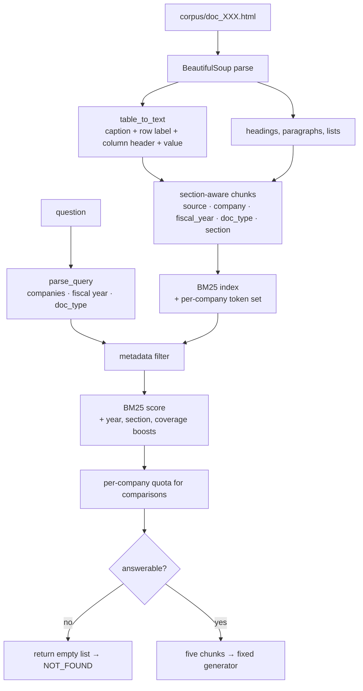

# FTEC5660 Homework 4 — the retrieval half of a RAG assistant

Name: Shuhan Jia · Student ID: 1155267069

The generator is fixed; everything that decides what it sees is here: HTML and table parsing,
section-aware chunking with metadata, query parsing, a lexical retriever that returns at most five
chunks, and an abstention rule for questions the corpus cannot answer.

## 1. How to run

```bash
python3 -m venv .venv && source .venv/bin/activate
pip install -r requirements.txt
echo "DEEPSEEK_API_KEY=your_key_here" > .env
python3 hw4.py --data-folder public_test     # writes results.csv and prints the scores
python3 ablation.py                          # Task 5 ladder, no LLM needed
```

By default `ablation.py` and `eval_local.py` call no model: they score tables, chunks, query parsing,
recall and abstention directly, so the ladder can be re-run without spending tokens. The table in
§3.2 was produced with `python3 ablation.py --with-generator`, which adds the official Task 4
accuracy of each variant by calling the real generator (about 280 calls, $0.05 in total).

## 2. Public-test results

| Task | What is measured | Public test |
|---|---|---|
| 1.1 | table cells kept with their row and column labels | 100.0% (12/12 tables) |
| 1.2 | documents whose chunks pass the metadata and probe checks | 100.0% (40/40) |
| 2.1 | answerable questions with a valid, non-empty retrieval | 100.0% |
| 2.2 | query fields right (companies / fiscal year / doc type) | 100.0% |
| 2.3 | recall@5 on answerable questions | 100.0% (46/46) |
| 3 | kept 100.0% · rejected 100.0% | Task 3 value 1.00 |
| 4 | answer accuracy of the fixed generator | 100.0% (46/46) |

A full run takes about six seconds for 40 documents, 790 chunks and 46 generator calls, well inside
the 30-minute limit, and costs $0.008 (54.6k input tokens, 165 output tokens).

## 3. Homework 4 solution

### 3.1 Pipeline



**Parsing.** Each `<table>` becomes text with one line per table row: the caption first (it carries
the unit), then `label | header: value | header: value`. Section rows such as "Assets" stay on their
own line. A row wider than 380 characters is split, repeating the row label, so no line ever exceeds
the 400-character limit and no line carries two row labels at once. Values are never reformatted:
`(1,762.4)` stays `(1,762.4)`.

**Chunking.** The document is walked in order; `<h2>`/`<h3>` set the current section, paragraphs and
lists become text, tables go through `table_to_text`. Blocks of the same section are packed into a
chunk of at most 1,500 characters, and every chunk starts with a header naming the company, the
fiscal year, the document type and the section. The header is the only text not taken verbatim from
the document, and it is what lets a chunk of a balance sheet say whose balance sheet it is. A long
table is split on line boundaries, so no figure is ever cut in half.

**Indexing and retrieval.** BM25 (rank-bm25, lower-cased whitespace tokens) over all chunks, plus the
company names seen in the corpus. `retrieve` parses the question, keeps only chunks of the named
company, the asked document type and the report years that can hold the figure — the asked year and,
if it exists, the following year, whose prior-year column repeats it. Within those candidates, three
terms are added to the BM25 score: +1.2 for the report of the asked year, +1.0 when the chunk's
section matches the question's topic (receivables → Note 4, borrowings → Note 5, target price →
valuation), and up to +1.5 in proportion to how much of the question's vocabulary the chunk contains.
Comparative questions get at most two chunks per company before the remaining slots are filled from
the global ranking, because five chunks of one company cannot support a comparison.

**Abstention.** `retrieve` returns `[]` in three cases: the question names a company that is not in
the corpus; the named fiscal year cannot be covered by any report (the corpus holds FY2023 figures
only inside the FY2024 report, so FY2021 and FY2022 are out of range); or a content word of the
question appears nowhere in that company's documents, which is the signature of a figure that is not
disclosed ("lobbying expenses", "carbon offset purchases", "customer churn rate", "largest single
customer"). Words are matched on their first six characters, so "borrowing" finds "borrowings" and
"programme" finds "program". A second, weaker rule abstains when even the best chunk covers less than
55% of the question's vocabulary.

### 3.2 Ablation (Task 5)

Every row adds one component to the row above it and is measured on the whole public set.
*Recall@5* is the handout's definition; *kept* and *rejected* are the two halves of Task 3;
*answer accuracy* is the official Task 4 score of that variant (`ablation.py --with-generator`);
*gold in context* is the share of the 60 questions whose gold answer is present in what the generator
would see, i.e. the ceiling that a perfect generator could reach.

| Variant | Change | recall@5 | kept | rejected | answer accuracy | gold in context |
|---|---|---|---|---|---|---|
| B0 | naive RAG (tutorial 7) | 26.1% | 100.0% | 0.0% | 43.3% | 40.0% |
| V1 | + table_to_text & section chunks | 84.8% | 100.0% | 0.0% | 85.0% | 66.7% |
| V2 | + metadata filter (query parsing) | 89.1% | 100.0% | 35.7% | 91.7% | 78.3% |
| V3 | + year/section/coverage boosts | 97.8% | 100.0% | 35.7% | 95.0% | 83.3% |
| V4 | + per-company quota | 100.0% | 100.0% | 35.7% | 96.7% | 85.0% |
| V5 | + abstention (submitted) | 100.0% | 100.0% | 100.0% | 100.0% | 100.0% |

**What each step bought.** Table text is by far the largest single lever: B0 → V1 is +58.7 points of
recall and +41.7 points of accuracy, because 22 of the 46 answerable questions ask for a figure inside
a table and naive `get_text()` turns a balance sheet into a stream of numbers with no row or column
attached to them. Metadata filtering adds 4.3 points of recall and 6.7 of accuracy, and, more
importantly, takes the rejected share from 0% to 35.7%: the five questions about FY2021/FY2022 are now
structurally impossible instead of accidentally answered. The ranking boosts add 8.7 points of recall
and 3.3 of accuracy by settling the ambiguity that BM25 cannot: every report mentions two years, so
"which 2024 column" has to come from the chunk's metadata, not from its words. The per-company quota
adds the last 2.2 points of recall and 1.7 of accuracy, all of them comparative questions that
previously received five chunks of the same company. Abstention does not change recall at all — that
is the point: it only moves the unanswerable questions from "answered with someone else's number" to
`[]`, which is what takes *gold in context* from 85.0% to 100.0% and closes the last five answers.

One thing the two columns disagree about is worth stating: accuracy is *above* gold-in-context at
every variant (43.3 vs 40.0, 96.7 vs 85.0). The gold-in-context test looks for the gold answer as a
string, so a chunk that holds `492.1` in a table row and a question whose gold answer is `492.1`
match, but a figure written as `USD 492.1 million` in prose does not. Accuracy is therefore the
truer number and gold-in-context only a floor: when the string is present the generator almost always
gets it right, which is why the accuracy column tracks it at roughly the same level.

### 3.3 Error analysis

The four failures I had to fix are more informative than the final score:

1. **`operating income` was classified as a research-report question.** The doc-type rule looked for
   the substring `rating`, which is inside `ope**rating**`. Five questions were mis-typed, two lost
   their recall and five unanswerable ones were kept. Matching `\brating\b` fixed all seven.
2. **Plurals and spelling broke abstention.** "long-term borrowing" never appears as such (the row is
   "Long-term borrowings"), nor does "programme" (the corpus writes "program"). Comparing the first
   six characters of each token instead of the whole token removed four false abstentions.
3. **"Q4" was treated as a content word.** "On its Q4 FY2025 earnings call…" abstained because no
   document contains the token `q4`. Quarter and unit words belong in the soft list, not in the test.
4. **Comparisons collapsed onto one company.** Before the quota, a question about Northgate Robotics
   versus Brightwater Software returned three chunks of the first company and two of its research
   report, never the second company's annual report. Two chunks per company fixed it.

**Remaining limits.** Retrieval is lexical, so a synonym outside the section hints is invisible:
"headcount" only works because I mapped it to the employees note, not because the index understands
it. Company extraction relies on capitalisation and on a list of words that are never part of a name,
which is fine for two- and three-word names and would fail for a one-word company. And abstention
tests presence, not disclosure: a figure that is mentioned but not given ("we do not disclose X")
would be kept and answered.

## 4. Reflection (Task 6)

Ten years from now, if a personal agent can write, code, research and decide as well as I can, the
honest answer is that most of what I am currently proud of will be ordinary. I would want to be the
person who decides what is worth doing and stands behind the decision. Not the one who produces the
most, but the one whose judgement other people are willing to act on.

The ambitions that would still matter are the ones that were never really about output. I want to
understand how a market actually works, not just describe it — why a credit spreads, why a desk says
no. I want to be trusted with other people's money and other people's problems, which is a
relationship, not a deliverable. And I want to keep learning in public: admit what I do not know,
say when I was wrong. An agent can generate an answer in a second; it cannot be embarrassed, and
therefore it cannot be trusted in the way a person who risks being wrong can be.

Beyond productivity I would want to be known for two things: that I am straight with people when it
is inconvenient, and that I bring calm to a room that is panicking. Both are cheap to say and
expensive to keep.

What am I willing to struggle for even when an agent could do it for me? Understanding something
from first principles. In this homework the tempting move was to let a model do the parsing and the
retrieval, and it would probably have scored better. I did it with rules and a lot of measuring
instead, because I wanted to know where the 26% came from and which single change moved it to 85%.
That experience — the seventy-point gap between a plausible pipeline and a correct one — is something
I could not have read in a summary. I am also willing to struggle for the parts of this work that are
relationships: sitting with a client who is worried, telling a colleague their model is wrong,
staying in a hard conversation instead of routing it.

The skills that stay valuable are the ones an agent cannot inherit: turning a vague question into
something testable, deciding what evidence would change my mind, and knowing which of two defensible
answers a particular institution can actually live with. My maths degree taught me to be suspicious
of a number without a definition; this course is teaching me that a retrieval system is mostly a
series of decisions about meaning, made explicit. Taste in problem selection, judgement under
uncertainty, and the willingness to be accountable for a call are not on the list of things a model
does better.

If my value is no longer what I can do, then I define myself by what I choose to be responsible for.
That is a relief rather than a threat: capability was never a stable identity anyway. What is stable
is the set of people I show up for, the standard I hold when nobody checks, and the questions I keep
asking after the answer has been generated.

What I should start doing differently tomorrow is small and specific: keep a written record of every
judgement I make and what would have proved me wrong, so that in ten years I can tell the difference
between having been right and having been lucky. And stop outsourcing the first draft of my thinking.
Use the agent for the second draft.
